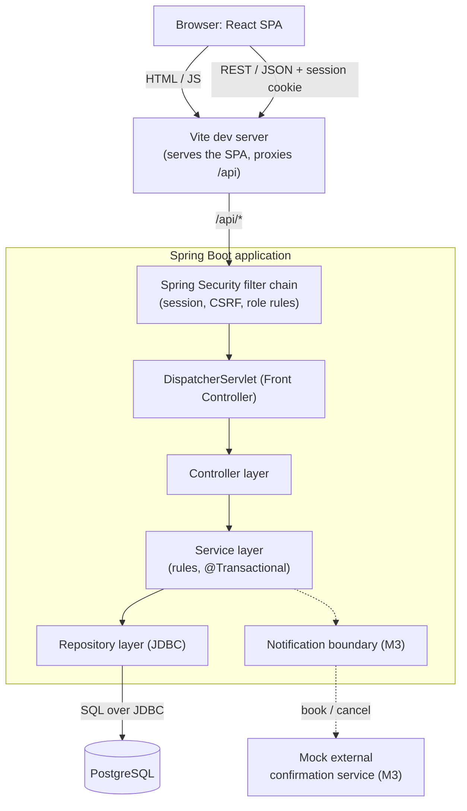

# Architecture

## Block diagram

Solid arrows are the request path as of Milestone 2. Dashed elements (the
notification boundary and the mock external service) are the Milestone 3
extension, shown here to mark the external-service boundary.

The SPA and the API share one origin through the Vite proxy, so the browser sends
the session cookie without any CORS setup. Spring Security runs before the
DispatcherServlet: it checks the CSRF token on every state-changing request,
loads the session, and rejects a request whose role does not match the URL
(`/api/appointments/**` is customer-only, `/api/provider/**` is provider-only)
before any controller runs.

## Layers

| Layer | Package | Responsibility |
| --- | --- | --- |
| Client | `frontend/` | React pages; calls the API with `fetch` |
| Security | `config` | Session login (BCrypt), CSRF, URL role rules, JSON 401/403 |
| Front Controller | *(Spring)* | `DispatcherServlet` receives every request and routes it to a handler |
| Controller | `controller` | HTTP mapping, parameter binding, input validation |
| Service | `service` | Business rules (ownership, slot state) and transaction boundaries |
| Repository | `repository` | Parameterized SQL over `NamedParameterJdbcTemplate`, including row locks |
| Database | PostgreSQL | Tables, constraints, and the double-booking backstop |

DTOs (`dto`) cross the wire; `model` holds the session principal and the small
records read under a lock; `config` holds security and the global exception
handler; `notification` is reserved for Milestone 3. See [request-flow.md](request-flow.md) for a request
traced through the layers.

## Constraints

- Java + Spring Boot; **SQL over JDBC, no ORM**.
- Liquibase is the only database initializer.
- Booking takes a row lock inside a transaction, and the database index is the
  final authority on double-booking (see [concurrency.md](concurrency.md)).
- Sessions live in the application's memory, so the app runs as a single
  instance. Running several instances would need a shared session store.
