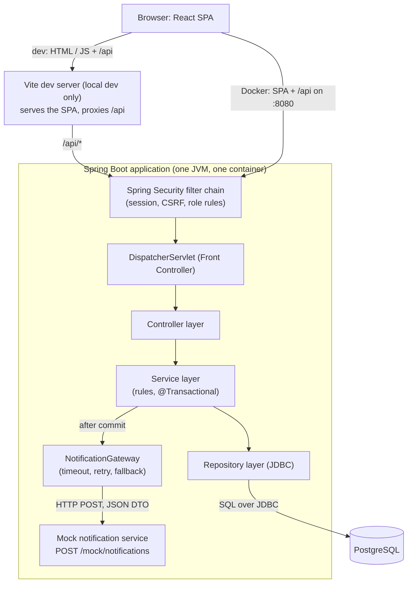
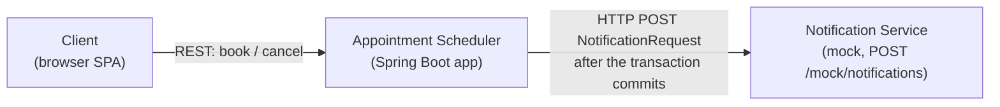
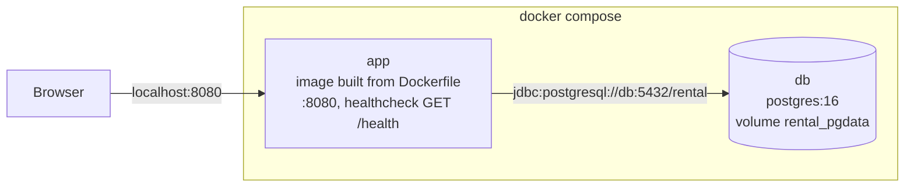

# Architecture

## Block diagram



In local development the Vite dev server serves the SPA and proxies `/api`. In the
Docker image the built SPA is bundled into the jar, so Spring Boot serves the
page and the API from one origin on port 8080. Either way the browser sends the
session cookie without any CORS setup. Spring Security runs before the
DispatcherServlet: it checks the CSRF token on every state-changing request,
loads the session, and rejects a request whose role does not match the URL
before any controller runs.

The mock notification service runs in the same JVM, but the application only
reaches it over HTTP through `NotificationGateway`, exactly as it would reach a
real external messaging system.

## Layers

| Layer | Package | Responsibility |
| --- | --- | --- |
| Client | `frontend/` | React pages; calls the API with `fetch` |
| Security | `config` | Session login (BCrypt), CSRF, URL role rules, JSON 401/403 |
| Front Controller | *(Spring)* | `DispatcherServlet` receives every request and routes it to a handler |
| Controller | `controller` | HTTP mapping, parameter binding, input validation, SPA deep-link forwards |
| Service | `service` | Business rules, transaction boundaries, commit-then-notify, the booking metric |
| Repository | `repository` | Parameterized SQL over `NamedParameterJdbcTemplate`, including row locks |
| Notification boundary | `notification` | `NotificationGateway`, the app's only way to reach the notification service |
| Mock external service | `notification.mock` | Stand-in messaging system behind `POST /mock/notifications` |
| Database | PostgreSQL | Tables, constraints, and the double-booking backstop |

DTOs (`dto`) cross the wire, including `NotificationRequest` on the notification
boundary; `model` holds the session principal and the small records read under a
lock; `config` holds security and the global exception handler. See
[request-flow.md](request-flow.md) for a request traced through the layers.

## Distribution boundary



### Coarse-grained interface

The scheduler sends one request per notification, and that request carries a
complete `NotificationRequest`:

```json
{"recipient": "customer@example.com", "type": "BOOKING_CONFIRMED",
 "message": "Your rental of Pressure Washer 3000 PSI (CLN-PW-004) starting 2027-09-06T16:00Z is confirmed.",
 "idempotencyKey": "appointment-34-BOOKING_CONFIRMED"}
```

Every remote call costs a network round trip and can fail on its own. A
fine-grained interface (set the recipient, set the message, then send) would
multiply the round trips and leave half-built notifications behind when one call
in the middle fails. One self-contained DTO means one call with one outcome.
`NotificationGateway` is the Gateway: the service layer calls a plain Java
method, `send(NotificationRequest)`, and never sees HTTP. Swapping the mock for
a real channel (a webhook or SMTP) would change only the gateway's internals or
its base URL, not the callers.

### Timeout, retry, and fallback

| Mechanism | Setting | Where |
| --- | --- | --- |
| Timeout | 1 s to connect, 1 s to read | `spring.http.client.*` in `application.yml` |
| Retry | 3 attempts, 200 ms then 400 ms backoff; I/O errors and 5xx are retried, a 4xx is not | `NotificationGateway.send` |
| Fallback | Log WARN per failed attempt and ERROR with the idempotency key, then return normally | `NotificationGateway.send` |

`send` never throws, so a booking succeeds whether the notifier is slow, down, or
rejecting requests. Measured against the Docker image: with the notifier down
(connection refused) a booking took 0.8 s; with a notifier that hangs, it took
3.75 s (three 1 s read timeouts plus backoff), and still returned 201.

### Commit first, then notify

`BookingTransaction.book` and `BookingTransaction.cancel` each run in their own
transaction. `BookingService` calls one, and only after it returns, which means
the transaction has committed, does it call the gateway:

```java
public AppointmentDto book(long customerId, long slotId) {
    AppointmentDto booked = timedBooking(customerId, slotId);   // transaction committed here
    notifications.send(notice(booked, "BOOKING_CONFIRMED", "is confirmed"));
    return booked;
}
```

This ordering means a customer is never told about a booking that later rolled
back, the slot's row lock and database connection are never held while waiting
on the network, and a notification failure cannot undo a booking.

### Idempotent retries

The idempotency key is `appointment-{id}-{type}`. It is the same on every retry,
and each appointment is confirmed once and cancelled at most once. The mock
service remembers the keys it has seen: a repeated key is acknowledged with 200
but not delivered again, while a new key gets 202. A retry after a read timeout
(where the first request may have arrived after all) therefore cannot send the
customer a second message.

### Trace IDs across the boundary

Micrometer Tracing puts a trace ID on every log line and the gateway's
`RestClient` forwards it in a W3C `traceparent` header. The booking's log line
and the mock's "Delivered" line share one trace ID, so one booking can be
followed across the boundary (see [operations.md](operations.md)). No tracing
backend is involved; the IDs exist for log correlation.

### Alternatives considered

- **Asynchronous send** (`@Async` or a queue in memory): removes the added
  latency, but a crash after the commit still loses the notification.
- **Transactional outbox plus a message broker such as Kafka**: write the
  notification to an outbox table in the same transaction as the booking, and
  have a relay publish it. This gives at-least-once delivery that survives a
  crash, at the cost of a broker, a relay, and more moving parts. It is the
  upgrade path if notifications become something that must never be lost.
- **Resilience4j** for retry and a circuit breaker: the standard library for
  this in production. The hand-written loop here is a dozen lines, matches the
  booking retry, and shows each step explicitly.

### Known limits

- A slow or down notifier adds up to about 3.7 s to a book or cancel request.
- A notification that fails all three attempts is logged and not re-sent.
- The mock's record of seen keys is in memory, unbounded, and lost on restart.
- The mock accepts requests only from loopback, so it cannot be called from
  outside the container.

## Deployment



The Dockerfile has three stages: Node builds the SPA, Maven packages the jar
with the SPA inside it, and the final stage runs the jar on a JRE as a non-root
user. Compose starts the app only once Postgres reports healthy, and then
probes the app's `/health` endpoint itself. See [operations.md](operations.md)
for logging, health, metrics, and the failure scenario.

## Constraints

- Java + Spring Boot; **SQL over JDBC, no ORM**.
- Liquibase is the only database initializer.
- Booking takes a row lock inside a transaction, and the database index is the
  final authority on double-booking (see [concurrency.md](concurrency.md)).
- Sessions and the mock's seen keys live in the application's memory, so the app
  runs as a single instance. Running several instances would need a shared
  session store.
