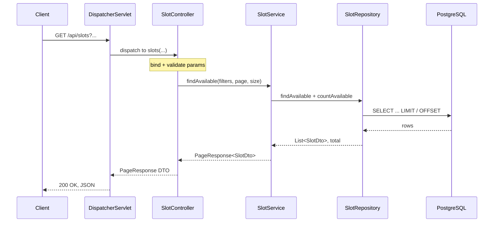
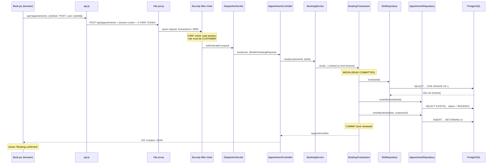

# Request Flow & Controller Pattern

## Request flow through the layers

Tracing `GET /api/slots?serviceId=1&date=2026-09-06&page=0&size=20`:

1. **DispatcherServlet** (Spring's front controller) receives the request and
   selects the handler by URL and HTTP method.
2. **SlotController** binds the query parameters, applies Bean Validation
   (`@Min`/`@Max`), and calls the service. Invalid input is turned into a
   `400 Bad Request` by `GlobalExceptionHandler`.
3. **SlotService** asks the repository for one page of results plus the total
   count, and wraps them in a `PageResponse`.
4. **SlotRepository** runs parameterized SQL over JDBC — a filtered query with
   `LIMIT`/`OFFSET`, and a matching `count(*)`.
5. Rows map to `SlotDto`; the DTO page returns up the stack and is serialized to
   JSON by the DispatcherServlet.

Files: [`SlotController`](../src/main/java/com/cmpe172/rental/controller/SlotController.java)
→ [`SlotService`](../src/main/java/com/cmpe172/rental/service/SlotService.java)
→ [`SlotRepository`](../src/main/java/com/cmpe172/rental/repository/SlotRepository.java).

## Booking a slot: frontend to backend and back

Tracing what happens when a signed-in customer clicks **Confirm booking**:

1. **Book.jsx** already has the slot's details from the row the customer clicked
   on the Slots page. On submit it calls `api()` from `api.js`.
2. **api.js** sends `fetch('/api/appointments')` with a JSON body. The browser
   attaches the session cookie by itself; `api.js` copies the `XSRF-TOKEN` cookie
   into the `X-XSRF-TOKEN` header.
3. The **Vite dev server** forwards everything under `/api` to Spring Boot on
   port 8080, so the browser only ever talks to one origin.
4. The **Spring Security filter chain** rejects the request before any
   controller runs if the CSRF token is missing (403), there is no session
   (401), or the user is not a customer (403). Those errors are written by
   `GlobalExceptionHandler` in the same JSON shape as every other error.
5. The **DispatcherServlet** routes to `AppointmentController.book`, which
   validates the body (`@Valid`, so a missing `slotId` is a 400) and takes the
   customer id from the session principal, not from the request.
6. **BookingService** calls **BookingTransaction** and retries only if the
   database reports a lock timeout or deadlock.
7. **BookingTransaction** is the transaction. It locks the slot row, checks that
   the slot is open, in the future, and not booked, then inserts the
   appointment. A taken slot throws `ConflictException`, which becomes a 409.
   See [concurrency.md](concurrency.md) for why the lock and the check are
   separate statements.
8. The new appointment is read back as an `AppointmentDto` and serialized to
   JSON with status 201. Book.jsx swaps the form for the confirmation view.

Files: [`frontend/src/pages/Book.jsx`](../frontend/src/pages/Book.jsx)
→ [`frontend/src/api.js`](../frontend/src/api.js)
→ [`SecurityConfig`](../src/main/java/com/cmpe172/rental/config/SecurityConfig.java)
→ [`AppointmentController`](../src/main/java/com/cmpe172/rental/controller/AppointmentController.java)
→ [`BookingService`](../src/main/java/com/cmpe172/rental/service/BookingService.java)
→ [`BookingTransaction`](../src/main/java/com/cmpe172/rental/service/BookingTransaction.java)
→ [`SlotRepository`](../src/main/java/com/cmpe172/rental/repository/SlotRepository.java)
/ [`AppointmentRepository`](../src/main/java/com/cmpe172/rental/repository/AppointmentRepository.java).

## Page Controller vs Front Controller

- **Page Controller** — one controller per page/action, typically rendering
  server-side HTML (e.g. Thymeleaf). The URL maps more or less directly to a
  page handler that produces markup.
- **Front Controller** — a single entry point receives *every* request and
  dispatches to the right handler. Cross-cutting concerns (routing, parsing,
  validation, serialization) live in that one place.

**This project uses the Front Controller pattern.** It exposes a REST/JSON API
consumed by the React SPA in `frontend/`, and Spring Boot's **`DispatcherServlet`** is the
front controller: all `/api/**` requests enter through it and are dispatched to
`@RestController` handlers that return DTOs (serialized to JSON), not rendered
HTML pages. There is no server-rendered page layer, so the Page Controller
pattern does not apply here.
